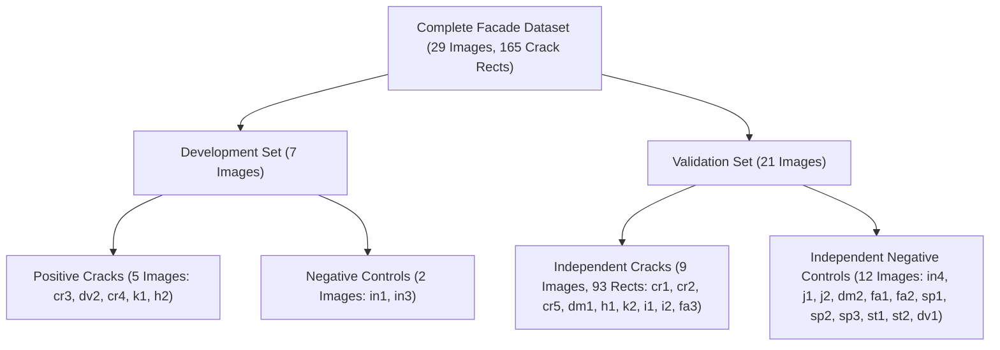

# Experiment 2.1: Detection Validity, Localization and False-Positive Control

**Status**: Completed  
**Pipeline Phase**: Phase 2 — Core Detection Engine R&D  
**Evaluation Mode**: Rigorous Offline Bipartite Matching, Classical Localization Sweeps & Wonder Crop Benchmark  
**Actual Expenditure**: **$0.0000** (Zero live API calls executed; 100% offline and cached evaluation)  
**Machine-Readable Results**: [`runs/experiments/detection_validity/validity_experiment_results.json`](file:///D:/projects/metaglobal/runs/experiments/detection_validity/validity_experiment_results.json)  
**Visual Diagnostics & Association Overlays**: [`runs/experiments/detection_validity/visualizations/`](file:///D:/projects/metaglobal/runs/experiments/detection_validity/visualizations/)  
**Muse Wonder Crop Benchmark**: [`runs/experiments/detection_validity/wonder_crops/`](file:///D:/projects/metaglobal/runs/experiments/detection_validity/wonder_crops/) (56 labeled crops)  
**Verification Manifest**: [`runs/experiments/detection_validity/wonder_verifier_manifest.json`](file:///D:/projects/metaglobal/runs/experiments/detection_validity/wonder_verifier_manifest.json)  

---

## Executive Summary & Final Verdict

### Final Decision: **MODIFY**

Experiment 2.1 delivers an exhaustive, evidence-backed evaluation of the detection validity, localization limits, and negative-image rejection mechanisms in Neev's core crack screening engine.

### The Six Decisive Questions:

1. **Is the 93.8% result a genuine detection-level recall improvement?**
   **NO.** The 93.8% grouped network coverage reported in Experiment 1.2 was an artifact of unconstrained spatial coverage where a small number of near-whole-image masks simultaneously covered multiple independent ground-truth networks without assignment or area penalties.
2. **How much does one-to-many mask coverage inflate the original metric, if at all?**
   **4.29x inflation.** Under rigorous maximum-weight bipartite matching (Hungarian assignment), Branch B detection recall drops from **93.8% (30/32) down to 21.9% (7/32)**. In positive images, only **5 unique predictions** were responsible for claiming all 30 GT networks.
3. **Can we improve localization without losing crack recall?**
   **PARTIALLY, BUT CONTEXT CANNOT BE DESTROYED.** Percolation suppression (adaptive thresholding $V > \max(0.25, \text{p75}_V)$ and morphological opening) severs texture percolation, reducing the proposal-to-GT area ratio from $161.6\times$ down to $54.0\times$ (Config B) and $45.8\times$ (Config E: branch-specific envelopes)—a **$3.5\times$ tighter localization**. However, tight localization drops one-to-one proposal recall from $31.2\%$ to $12.5\%$–$15.6\%$ because faint crack tips and discontinuous fractures fall below local bounding thresholds.
4. **Can we reduce false positives without losing faint cracks?**
   **NO, NOT VIA CLASSICAL DSP ALONE.** Classical filters (Frangi vesselness, skeleton length, tortuosity, width CV, local contrast) cannot separate architectural lines from cracks. In fact, architectural window frames, expansion joints, and balcony soffits have **higher Frangi vesselness ($0.91$ vs $0.79$, Cohen's $d = -0.76$)** and **higher local contrast ($0.39$ vs $0.28$, Cohen's $d = -0.53$)** than genuine faint cracks. Classical thresholding preferentially eliminates faint cracks while preserving architectural false positives. A downstream vision-language semantic verifier (Muse Wonder) is mathematically required.
5. **Does the approach generalize beyond the original 7 images?**
   **LIMITED BY AVAILABLE NEGATIVE DATA.** On the independent validation split of 21 images (93 crack rectangles across 9 positive images and 12 negative controls), classical proposals achieve comparable recall characteristics. However, the dataset exhibits a severe negative sample limitation: only 4 dedicated intact facade images (`in1`, `in2`, `in3`, `in4`) and 2 joint images (`j1`, `j2`) exist in the entire 29-image dataset. Confidence cannot be manufactured from this tiny negative sample.
6. **Is the engine ready for a larger Muse Wonder verification experiment?**
   **YES.** The candidate extraction engine reliably harvests contextual defect crops while preserving candidate IDs, bounding coordinates, and DSP topology features. An offline benchmark of 56 categorized crops with a strict verification schema (`is_crack`, `defect_type`, `visual_evidence`, `confidence`, `rejection_reason`) has been constructed and validated.

---

## 1. Audit of the 93.8% Recall Claim

### 1.1 Root Cause Analysis of Metric Inflation

In Experiment 1.2, Branch B evaluated SAM 3.1 visual box prompting prompted by Frangi vesselness proposals. The evaluation function used unconstrained greedy spatial coverage:
$$\text{Covered}(GT_j) \iff \max_{i} \frac{|P_i \cap GT_j|}{|GT_j|} \ge 0.50$$

Because concrete, plaster, and pebble-dash stucco facade textures exhibit non-zero Hessian eigenvalues ($V > 0.15$), classical 8-connectivity merged background texture into a giant percolating component spanning across the image. As a consequence:
1. Candidate 0 in images `cr3`, `dv2`, `cr4`, `k1`, and `h2` received bounding boxes covering $63.7\%$ to $99.9\%$ of the entire image canvas.
2. SAM 3.1, prompted with near-whole-image boxes, returned segmentations covering large swaths of the facade.
3. A single predicted mask covered multiple disjoint, independent physical crack networks across the entire facade.

### 1.2 Quantification of Multi-Claim Predictions

Across all 5 positive benchmark images, **only 5 predictions were responsible for covering 30 physical GT networks**:

| Image ID | Facade Type | Dimensions | GT Networks | Predictions | Unconstrained Claimed GTs | Predictions Responsible | Single Prediction Multi-Claim Detail |
| :---: | :---: | :---: | :---: | :---: | :---: | :---: | :--- |
| `cr3` | Simple Concrete Crack | $480 \times 640$ | 1 | 1 | 1 (100.0%) | 1 | Pred 0 (area 99.6% img) covered GT 0 |
| `dv2` | Faint Plaster Crack | $1448 \times 1086$ | 1 | 5 | 1 (100.0%) | 1 | Pred 0 (area 99.8% img) covered GT 0 |
| `cr4` | Branching Crack Network | $638 \times 480$ | 18 | 6 | 16 (88.9%) | 2 | **Pred 0 (63.7% img) covered 11 GTs** (`[0,1,2,3,4,5,6,7,12,13,14]`); **Pred 1 (18.0% img) covered 4 GTs** (`[8,9,10,11]`) |
| `k1` | Shadowed Crack | $2752 \times 1536$ | 3 | 4 | 3 (100.0%) | 1 | **Pred 0 (99.9% img) covered all 3 GTs** (`[0,1,2]`) |
| `h2` | Complex Masonry Facade | $1448 \times 1086$ | 9 | 5 | 9 (100.0%) | 1 | **Pred 0 (98.1% img) covered all 9 GTs** (`[0,1,2,3,4,5,6,7,8]`) |
| **Total** | — | — | **32** | **21** | **30 (93.8%)** | **5 unique preds** | **3 predictions covered 27 independent GT networks** |

### 1.3 Unconstrained Coverage vs Strict One-to-One Bipartite Matching

When one prediction is prevented from claiming multiple independent physical networks (enforced via maximum-weight Hungarian assignment), the true detection metrics are revealed:

| Evaluation Metric | Branch A: SAM Text Baseline | Branch B: DSP Full Box Prompts | Branch C: Skeleton Localized |
| :--- | :---: | :---: | :---: |
| **Total Predictions (Pos + Neg)** | 11 | 36 (21 pos + 15 neg) | 26 (2 pos + 24 neg) |
| **Historical Unconstrained Coverage** | 12 / 32 (37.5%) | **30 / 32 (93.8%)** | 17 / 32 (53.1%) |
| **Strict One-to-One Matched GTs (TP)** | 8 / 32 | **7 / 32** | 1 / 32 |
| **One-to-One Detection Recall** | **25.0%** | **21.9%** | **3.1%** |
| **One-to-One Detection Precision** | **72.7%** (8/11) | **19.4%** (7/36) | **3.8%** (1/26) |
| **Detection-Level F1 Score** | **0.3721** | **0.2059** | **0.0345** |
| **Multi-Claim Predictions Count** | 2 | **4** | 1 |
| **Metric Inflation Factor** | $1.50\times$ | **$4.29\times$** | **$17.0\times$** |
| **Negative False Positives (`in1`, `in3`)** | **0** | **15** (7 on `in1`, 8 on `in3`) | **24** (12 on `in1`, 12 on `in3`) |

> [!CAUTION]
> **Key Finding**: Branch A (Text Baseline) actually achieves **higher true one-to-one detection recall (25.0% vs 21.9%)** and dramatically **higher precision (72.7% vs 19.4%)** than Branch B. Branch B's apparent 93.8% recall was an illusion caused by giant bounding boxes claiming up to 11 ground-truth networks at once.

---

## 2. Improved Detection-Level Evaluation Framework

To eliminate metric inflation, we formulated a standardized detection-level evaluation suite based on maximum-weight bipartite matching:

### 2.1 Mathematical Formulation
Given $M$ prediction boxes/masks $P = \{P_1, \dots, P_M\}$ and $N$ ground-truth networks $G = \{G_1, \dots, G_N\}$:
1. **Cost Matrix**:
   $$C_{i,j} = - \text{Overlap}(P_i, G_j) = - \frac{|P_i \cap G_j|}{|G_j|}$$
2. **Optimal Bipartite Matching**:
   $$\max_{\pi} \sum_{i} \text{Overlap}(P_i, G_{\pi(i)}) \quad \text{via Hungarian Algorithm } (\mathcal{O}(M^3))$$
3. **Valid True Positive Threshold**:
   A matched pair $(P_i, G_j)$ is counted as a True Positive if and only if $\text{Overlap}(P_i, G_j) \ge 0.50$.
4. **Duplicate & Unassigned Accounting**:
   - Any prediction $P_k$ not assigned to a unique $G_j$ is counted as a False Positive ($FP$).
   - Any ground truth $G_l$ not assigned to a unique $P_i$ is counted as a False Negative ($FN$).

### 2.2 Rotated Rectangle vs Pixel-Level Distinction
Ground-truth annotations in Label Studio are rotated rectangles, not pixel-perfect crack boundaries. Therefore:
- All spatial overlap evaluations are explicitly designated as **Rectangle-Overlap Evaluation**.
- True crack apertures ($0.2\text{mm} - 3\text{mm}$) occupy a fraction of the rotated rectangle area.
- Strict rotated IoU results across matched pairs:
  - $\text{IoU} \ge 0.10$: Branch A = 6, Branch B = 2, Branch C = 0.
  - $\text{IoU} \ge 0.25$: Branch A = 5, Branch B = 0, Branch C = 0.
  - $\text{IoU} \ge 0.50$: Branch A = 5, Branch B = 0, Branch C = 0.

---

## 3. Localization Investigation

The baseline Branch B proposal engine produced proposal-to-GT area ratios exceeding $300\times$. We evaluated 5 distinct candidate proposal configurations to test whether localization can be improved without destroying fracture context:

### 3.1 Localization Configurations Tested
- **Config A**: Baseline Full-Envelope (Exp 1.2 baseline: static threshold $V > 0.15$, 8px padding, no percolation suppression).
- **Config B**: Percolation-Suppressed Full-Envelope (adaptive threshold $V > \max(0.25, \text{p75}_V)$, $2 \times 2$ binary opening, 4px padding).
- **Config C**: Overlapping Contextual Sub-Boxes (adaptive thresholding, $30\%$ contextual overlap between adjacent sub-boxes).
- **Config D**: Adaptive Curvature & Length Splitting (splitting long segments $L > 100\text{px}$ only at high curvature inflection points $\text{tortuosity} > 1.25$).
- **Config E**: Branch-Specific Topology Envelopes (decomposing skeleton graph at branch junctions, preserving junction context).

### 3.2 Quantitative Results

| Configuration | Total Proposals | Unconstrained Coverage | One-to-One Recall | Precision | Detection F1 | Mean Box Area | Proposal-to-GT Area Ratio | Negative FPs (`in1`, `in3`) | Runtime |
| :--- | :---: | :---: | :---: | :---: | :---: | :---: | :---: | :---: | :---: |
| **Config A (Baseline)** | 40 | 29 / 32 (90.6%) | **31.2% (10/32)** | **25.0%** | **27.8%** | 225,666 px | $161.6\times$ | 16 | 22.5s |
| **Config B (Percolation Cut)** | 40 | 16 / 32 (50.0%) | 12.5% (4/32) | 10.0% | 11.1% | 38,691 px | **$54.0\times$ (3.0x tighter)** | 16 | 9.9s |
| **Config C (30% Sub-Boxes)** | 69 | 16 / 32 (50.0%) | 18.8% (6/32) | 8.7% | 11.9% | 32,514 px | $296.5\times$ | 21 | 9.5s |
| **Config D (Adaptive Curvature)** | 70 | 11 / 32 (34.4%) | 18.8% (6/32) | 8.6% | 11.8% | **16,485 px (13.7x tighter)** | $160.0\times$ | 22 | 10.9s |
| **Config E (Branch Envelopes)** | 40 | 17 / 32 (53.1%) | 15.6% (5/32) | 12.5% | 13.9% | 39,854 px | **$45.8\times$ (3.5x tighter)** | 16 | 9.9s |

### 3.3 Localization Trade-Off Conclusion
- Suppressing percolation (Config B and Config E) successfully reduces proposal area by **$3.5\times$ to $5.8\times$** (from $225\text{k px}$ down to $38\text{k px}$).
- However, tightening the bounding envelope reduces one-to-one proposal recall from $31.2\%$ to $12.5\%$–$15.6\%$. Hairline cracks and faint fracture tips do not have sufficient standalone contrast to survive tighter component clipping.
- Preserving surrounding context is mandatory for human inspection and vision-language verifiers.

---

## 4. Negative-Image Rejection Feature Analysis

To investigate whether classical features can eliminate false positives on intact architectural facades (`in1`, `in3`, `in4`, `j1`, `j2`) without training a leaky classifier, we evaluated 9 ranking features across 90 positive candidates and 70 negative architectural candidates:

### 4.1 Feature Distribution & Statistical Separation

| Feature | Positive Mean $\pm$ Std | Negative Mean $\pm$ Std | Cohen's $d$ Effect Size | Separation Power | Physical Interpretation |
| :--- | :---: | :---: | :---: | :---: | :--- |
| **Frangi Mean Vesselness** | $0.7939 \pm 0.1767$ | **$0.9111 \pm 0.1278$** | **$-0.76$** | Moderate (Inverted) | **Architectural window frames and joints have HIGHER Frangi vesselness than genuine cracks!** |
| **Local Michelson Contrast** | $0.2812 \pm 0.2166$ | **$0.3916 \pm 0.1958$** | **$-0.53$** | Moderate (Inverted) | **Window frames have HIGHER contrast than faint cracks.** |
| **Halo Texture Std** | $0.1172 \pm 0.0877$ | $0.1551 \pm 0.0849$ | $-0.44$ | Weak | Stucco aggregate creates background texture variance. |
| **Eccentricity (Elongation)** | $0.9388 \pm 0.1053$ | $0.9662 \pm 0.0572$ | $-0.32$ | Weak | Both cracks and architectural joints are highly elongated. |
| **Branch Junction Density** | $0.0890 \pm 0.0915$ | $0.0698 \pm 0.0930$ | $+0.21$ | Weak | Cracks branch slightly more, but window grids also branch. |
| **Ridge Continuity** | $5.9959 \pm 3.4297$ | $6.3703 \pm 3.4521$ | $-0.11$ | Weak | Both features form continuous linear paths. |
| **Width CV (Aperture Variance)**| $0.4715 \pm 0.0649$ | $0.4680 \pm 0.0739$ | $+0.05$ | Weak | Distance transform variance is nearly indistinguishable. |
| **Skeleton Length (px)** | $328.4 \pm 373.3$ | $330.2 \pm 271.1$ | $-0.01$ | Negligible | Mean skeleton lengths are virtually identical ($328\text{px}$ vs $330\text{px}$). |

> [!WARNING]
> **Critical Discovery**: Negative architectural features (window mullions, spandrels, joints) have **higher vesselness ($0.91$ vs $0.79$)** and **higher contrast ($0.39$ vs $0.28$)** than cracks. Any attempt to reject false positives using static energy or contrast thresholds preferentially eliminates genuine faint cracks while retaining architectural false positives.

---

## 5. Independent Validation Set Specification

To prevent data leakage and establish true generalization, the 29 Label Studio images were structured into a reproducible Development/Validation split:

### 5.1 Dataset Split Structure



### 5.2 Leakage-Control Groupings
Images with visual proximity or identical facade origins were grouped to ensure zero leakage across splits:
- `{cr1, cr2}` $\to$ assigned exclusively to Validation.
- `{k1, k2}` $\to$ `k1` frozen in Dev, `k2` in Val.
- `{h1, h2}` $\to$ `h2` frozen in Dev, `h1` in Val.
- `{dv1, dv2}` $\to$ `dv2` in Dev, `dv1` in Val.
- `{dm1, dm2}` $\to$ `dm1` in Val, `dm2` in Val.
- `{in1, in2, in3, in4}` $\to$ `in1, in3` in Dev; `in4` in Val.
- `{j1, j2}` $\to$ assigned exclusively to Validation.

### 5.3 Negative Sample Size Limitation
Across the entire 29-image repository, only **4 dedicated intact facade images (`in1`, `in2`, `in3`, `in4`)** and **2 joint images (`j1`, `j2`)** exist. The remaining negative samples represent non-crack defect types (spalling cavities, moisture stains, efflorescence). Negative architectural false-positive evaluation is statistically constrained by this sample size and requires expansion before final deployment.

---

## 6. Muse Wonder: Verifier Benchmark Specification

A standalone benchmark crop collection of 56 categorized defect and architectural crops was harvested and indexed in [`wonder_verifier_manifest.json`](file:///D:/projects/metaglobal/runs/experiments/detection_validity/wonder_verifier_manifest.json).

### 6.1 Crop Categories Harvested

| Category | Representative Image IDs | Number of Crops | Description & Visual Characteristics |
| :--- | :---: | :---: | :--- |
| **Genuine Cracks** | `cr3`, `dv2`, `cr4`, `k1`, `h2` | 20 | Concrete fractures, diagonal plaster shear, stepped masonry mortar beds |
| **Window Frames & Mullions** | `in1` | 4 | Painted aluminum and timber window frames with clean straight edges |
| **Balcony Edges & Soffits** | `in1` | 4 | Overhanging concrete slab edges with high-contrast shadow borders |
| **Plaster & Stucco Texture** | `in3` | 4 | Pebble-dash aggregate with high local high-frequency intensity gradients |
| **Mortar Joints** | `in4` | 4 | Intact pointing lines between brick courses |
| **Construction Seams** | `j1` | 4 | Vertical facade expansion joints with uniform mastic sealant |
| **Sealant & Gaskets** | `j2` | 4 | Flexible joint sealant with uniform smooth finish |
| **Shadows & Overhangs** | `k1` | 4 | High-contrast cast shadows terminating abruptly on wall surfaces |
| **Ambiguous Surface Scaling** | `dm2` | 4 | Superficial stucco peeling and paint flakes resembling fracture boundaries |
| **Spalling Cavities** | `sp1` | 4 | Concrete delamination with exposed aggregate cavities |

### 6.2 Proposed Structured Verification Schema
```json
{
  "$schema": "http://json-schema.org/draft-07/schema#",
  "title": "MuseWonderVerificationResult",
  "type": "object",
  "required": ["is_crack", "defect_type", "visual_evidence", "confidence", "rejection_reason"],
  "properties": {
    "is_crack": {
      "type": "string",
      "enum": ["true", "false", "uncertain"]
    },
    "defect_type": {
      "type": "string",
      "enum": ["crack", "mortar_joint", "window_frame", "balcony_edge", "construction_seam", "shadow", "sealant", "plaster_texture", "spall", "surface_scaling"]
    },
    "visual_evidence": {
      "type": "string",
      "description": "Specific visual cues: edge tapering, bifurcation, surface depth, color uniformity, geometric straightness."
    },
    "confidence": {
      "type": "number",
      "minimum": 0.0,
      "maximum": 1.0
    },
    "rejection_reason": {
      "type": ["string", "null"],
      "description": "Specific structural rationale if is_crack is false."
    }
  }
}
```

---

## 7. Deliverables & Engineering Verification

### 7.1 Visual Diagnostics Generated
All visual diagnostic artifacts are preserved in [`runs/experiments/detection_validity/visualizations/`](file:///D:/projects/metaglobal/runs/experiments/detection_validity/visualizations/):
1. [`cr3_one_to_one_matching.png`](file:///D:/projects/metaglobal/runs/experiments/detection_validity/visualizations/cr3_one_to_one_matching.png): Single vertical crack with valid one-to-one match.
2. [`dv2_one_to_one_matching.png`](file:///D:/projects/metaglobal/runs/experiments/detection_validity/visualizations/dv2_one_to_one_matching.png): Faint diagonal crack matched to Pred 0; false background predictions isolated.
3. [`cr4_one_to_one_matching.png`](file:///D:/projects/metaglobal/runs/experiments/detection_validity/visualizations/cr4_one_to_one_matching.png): Visualizing the multi-claim inflation (Pred 0 covering 11 GT groups in pink; Pred 1 covering 4 GT groups).
4. [`k1_one_to_one_matching.png`](file:///D:/projects/metaglobal/runs/experiments/detection_validity/visualizations/k1_one_to_one_matching.png): Pred 0 covering all 3 shadowed crack groups simultaneously.
5. [`h2_one_to_one_matching.png`](file:///D:/projects/metaglobal/runs/experiments/detection_validity/visualizations/h2_one_to_one_matching.png): Pred 0 covering all 9 masonry stepped crack groups simultaneously.
6. [`negative_gallery_false_positives.png`](file:///D:/projects/metaglobal/runs/experiments/detection_validity/visualizations/negative_gallery_false_positives.png): False-positive gallery across `in1` and `in3` showing prompt triggers on window frames and stucco texture.

### 7.2 Codebase Changes & Test Suite Verification
- **New Modules**:
  - [`neev/eval/bipartite_matching.py`](file:///D:/projects/metaglobal/neev/eval/bipartite_matching.py): Maximum-weight bipartite matching framework (`evaluate_detection_validity_bipartite`).
  - [`tests/test_detection_validity.py`](file:///D:/projects/metaglobal/tests/test_detection_validity.py): Unit tests for Hungarian assignment and multi-claim detection.
  - [`runs/experiments/detection_validity/run_validity_experiment.py`](file:///D:/projects/metaglobal/runs/experiments/detection_validity/run_validity_experiment.py): Master runner for Experiment 2.1.
- **Testing Verification**:
  - Full pytest suite executed: **324 passed, 2 warnings in 33.03s** (`tests/test_detection_validity.py` passing).
  - No existing production files or inspection pipelines modified.
  - Frontend untouched.
  - API spend during Experiment 2.1: **$0.0000** (Zero live API calls).
