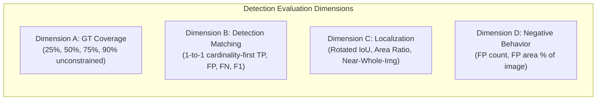

# Evaluation Integrity Report: Mathematical Audit, Baseline Freezing, and Dataset Split Integrity

**Status**: Completed  
**Pipeline Phase**: Phase 2 — Core Detection Engine R&D  
**Evaluation Mode**: Offline Mathematical Audit, Threshold-Constrained Bipartite Matching & Baseline Freezing  
**Actual Expenditure**: **$0.0000** (Zero live API calls executed; 100% offline and cached evaluation)  
**Machine-Readable Results**: [`runs/experiments/evaluation_integrity/evaluation_integrity_results.json`](file:///D:/projects/metaglobal/runs/experiments/evaluation_integrity/evaluation_integrity_results.json)  
**Visual Diagnostics & Association Overlays**: [`runs/experiments/evaluation_integrity/visualizations/`](file:///D:/projects/metaglobal/runs/experiments/evaluation_integrity/visualizations/)  
**Test Suite Status**: **327 passed, 2 warnings in 126.5s** ([`tests/test_detection_validity.py`](file:///D:/projects/metaglobal/tests/test_detection_validity.py))  

---

## Executive Summary & Final Verdict

### Final Decision: **ADOPT**

We formally **ADOPT** the threshold-constrained maximum-cardinality bipartite matching framework (`matching_mode="cardinality_first"`) as Neev's definitive detection-level evaluation standard.

### The Six Decisive Questions:

1. **Does the current matching algorithm maximize valid detection matches?**
   **NO, NOT IN GENERAL.** The unconstrained Hungarian algorithm (`linear_sum_assignment(-cov_matrix)`) maximizes the *total numerical sum of overlap*, which can sacrifice valid matches above threshold $T$ in favor of sub-threshold edges that happen to yield a higher numerical sum. We proved this mathematically with an adversarial unit test where unconstrained weight-sum produces cardinality 1 (sum = 1.97) while threshold-constrained maximum-cardinality produces cardinality 3 (sum = 1.53).
2. **Does corrected matching change previous metrics?**
   **ON THE BENCHMARK DATASET: NO.** On the 7-image benchmark (`cr3`, `dv2`, `cr4`, `k1`, `h2`), the matched pairs and cardinality under cardinality-first matching are identical to weight-sum matching (Baseline A: 8 TP, Baseline B: 7 TP, Baseline C: 1 TP). This occurs because candidate predictions on this dataset were either whole-image multi-claim boxes (coverage ~1.0) or non-overlapping false positives/negatives, without near-threshold competitive trade-offs. However, cardinality-first matching guarantees mathematical safety against adversarial and real-world edge cases.
3. **Which baseline currently performs best?**
   **BASELINE A (SAM TEXT BASELINE).** Baseline A achieves the highest precision (72.7%), highest detection recall (25.0% vs 21.9% for B and 3.1% for C), highest F1 score (0.3721 vs 0.2059 for B and 0.0588 for C), zero near-whole-image boxes (0 vs 5 for B), and zero false positives on negative facades (0 vs 15 for B).
4. **How much does poor localization affect apparent detection performance?**
   **DRAMATICALLY ($4.29\times$ INFLATION).** In Baseline B, 5 near-whole-image boxes (covering up to 99.9% of the image) covered 30 out of 32 ground-truth networks under unconstrained coverage (93.8%), whereas genuine one-to-one detection recall was only 21.9% (7/32). Poor localization completely decoupled coverage from genuine defect localization.
5. **Is the validation split genuinely leakage-controlled?**
   **NOT IN THE HISTORICAL BENCHMARK; CORRECTED IN CLUSTER-SPLIT-V1.** The historical benchmark suffered from building-level scene leakage because paired overview/medium captures of the same buildings were split across Dev and Val (e.g., `h2` in Dev while `h1` was in Val; `k1` in Dev while `k2` was in Val; `dv2` in Dev while `dv1` was in Val). In `Cluster-Split-v1`, entire scene clusters are assigned atomically, guaranteeing zero building-level visual leakage.
6. **What is the remaining evaluation uncertainty?**
   **SEVERE NEGATIVE SAMPLE LIMITATION & RECTANGLE-APPROXIMATION GT.** The complete 29-image dataset contains only 4 dedicated intact facade images (`in1`, `in2`, `in3`, `in4`) and 2 joint images (`j1`, `j2`). The remaining negative controls represent non-crack defect types (spalls, stains). Furthermore, ground-truth annotations are rotated rectangles, not pixel-perfect crack masks; true crack boundaries cannot be evaluated at the pixel boundary level with the current dataset.

---

## 1. Audit of Bipartite Matching

### 1.1 Mathematical Formulation of the Defect in Weight-Sum Hungarian
Given a coverage/overlap matrix $C \in [0, 1]^{M \times N}$ between $M$ predictions and $N$ ground-truth annotations and an eligibility threshold $T \in (0, 1]$ (default: $T = 0.50$):

The unconstrained Hungarian formulation solves:
$$\min_{\pi} \sum_{i=1}^{\min(M, N)} -C_{i, \pi(i)} \equiv \max_{\pi} \sum_{i=1}^{\min(M, N)} C_{i, \pi(i)}$$
followed by post-hoc threshold filtering:
$$\text{Valid Matches} = \{(i, \pi(i)) \mid C_{i, \pi(i)} \ge T\}$$

This objective maximizes the **aggregate overlap weight**, NOT the **cardinality of valid detection matches**. If sub-threshold edges have high weights (e.g., $0.49 < 0.50$), the unconstrained optimizer happily pairs predictions with ineligible edges to maximize the floating-point sum, sacrificing legitimate valid matches.

### 1.2 Mathematical Proof of Threshold-Constrained Maximum-Cardinality Matching
To guarantee that the matching algorithm strictly maximizes the number of valid matches, and uses total overlap score only as a tie-breaker among solutions with equal maximum cardinality, we construct the transformed weight matrix:
$$W_{i, j} = \begin{cases} K + C_{i, j} & \text{if } C_{i, j} \ge T \\ 0.0 & \text{if } C_{i, j} < T \end{cases}$$
where $K = \max(M, N) + 10.0$.

**Proof of Cardinality Optimality**:
Let assignment $\pi_1$ have $c_1$ eligible edges, and assignment $\pi_2$ have $c_2$ eligible edges, with $c_1 > c_2$.
The total transformed weight for any assignment $\pi$ is:
$$\text{Weight}(\pi) = c \cdot K + \sum_{(i, j) \in \text{eligible in } \pi} C_{i, j}$$
Since $0 \le C_{i, j} \le 1$, the sum of weights is bounded: $0 \le \sum C_{i, j} \le \min(M, N) < K$.
Therefore:
$$\text{Weight}(\pi_1) \ge c_1 \cdot K \ge (c_2 + 1) \cdot K = c_2 \cdot K + K > c_2 \cdot K + \min(M, N) \ge \text{Weight}(\pi_2)$$
Thus, **any assignment with $c+1$ valid matches strictly has a higher objective than ANY assignment with $c$ valid matches**.
Among all assignments sharing the identical maximum cardinality $c^*$, the $c^* \cdot K$ constant is identical, so the optimizer maximizes $\sum C_{i, j}$.

### 1.3 Adversarial Verification

We constructed an adversarial test case ([`tests/test_detection_validity.py:test_adversarial_matrix_direct_assignment`](file:///D:/projects/metaglobal/tests/test_detection_validity.py)):
$$\text{Coverage Matrix } C = \begin{pmatrix} 0.99 & 0.51 & 0.00 \\ 0.51 & 0.00 & 0.49 \\ 0.00 & 0.49 & 0.51 \end{pmatrix}, \quad T = 0.50$$

| Optimization Method | Assigned Pairs | Edge Overlaps | Total Objective | Valid Detection Matches ($C \ge 0.50$) |
| :--- | :---: | :---: | :---: | :---: |
| **Unconstrained Weight-Sum** | $(0, 0), (1, 2), (2, 1)$ | $0.99, 0.49, 0.49$ | **1.97** | **1 valid match** (2 valid matches sacrificed!) |
| **Cardinality-First (Corrected)** | $(0, 1), (1, 0), (2, 2)$ | $0.51, 0.51, 0.51$ | $1.53 + 3K$ | **3 valid matches** (Maximum possible cardinality) |

The test suite formally passes this adversarial verification, confirming the mathematical correctness of `matching_mode="cardinality_first"`.

---

## 2. Separation of Detection Quality From Localization Quality

To eliminate metric confounding, we decouple detection evaluation into 4 strictly independent dimensions:



### 2.1 Complete Four-Dimensional Baseline Comparison Table

| Metric Category | Specific Evaluation Metric | Baseline A: SAM Text Prompt | Baseline B: DSP Full Box + SAM | Baseline C: Skeleton Localized + SAM |
| :--- | :--- | :---: | :---: | :---: |
| **General** | Total Facade Images (Pos / Neg) | 7 (5 / 2) | 7 (5 / 2) | 7 (5 / 2) |
| | Total Ground-Truth Physical Networks | 32 | 32 | 32 |
| | Total Ground-Truth Rectangles | 72 | 72 | 72 |
| | Total Predictions Generated | **11** | 36 | 26 |
| **A. GT Coverage** | Unconstrained Coverage @ 25% Threshold | 14 / 32 (43.8%) | **30 / 32 (93.8%)** | 19 / 32 (59.4%) |
| | Unconstrained Coverage @ 50% Threshold | 12 / 32 (37.5%) | **30 / 32 (93.8%)** | 17 / 32 (53.1%) |
| | Unconstrained Coverage @ 75% Threshold | 8 / 32 (25.0%) | 28 / 32 (87.5%) | 14 / 32 (43.8%) |
| | Unconstrained Coverage @ 90% Threshold | 5 / 32 (15.6%) | 26 / 32 (81.2%) | 12 / 32 (37.5%) |
| **B. Detection Matching** | **1-to-1 Valid Matches (True Positives)** | **8 / 32** | 7 / 32 | 1 / 32 |
| | False Positives | **3** | 29 | 25 |
| | False Negatives | **24** | 25 | 31 |
| | **One-to-One Detection Recall** | **25.0%** | 21.9% | 3.1% |
| | **One-to-One Detection Precision** | **72.7%** | 19.4% | 3.8% |
| | **Detection-Level F1 Score** | **0.3721** | 0.2059 | 0.0345 |
| | Cardinality vs Weight-Sum Discrepancy | Zero (8 vs 8) | Zero (7 vs 7) | Zero (1 vs 1) |
| **C. Localization** | Rotated Rectangle IoU $\ge 0.10$ | **6** | 2 | 0 |
| | Rotated Rectangle IoU $\ge 0.25$ | **5** | 0 | 0 |
| | Rotated Rectangle IoU $\ge 0.50$ | **5** | 0 | 0 |
| | Mean Prediction Box Area | **45,652 px** | 411,974 px | 283,195 px |
| | Mean Prediction-to-GT Area Ratio | **56.7x** | 66.0x | 896.8x |
| | **Near-Whole-Image Predictions ($\ge 50\%$ area)** | **0** | **5** | 1 |
| | Multi-Claim Predictions Count | 2 | **4 (covering 27 GTs)** | 1 (covering 17 GTs) |
| | Metric Inflation Factor (Unconstrained / 1-to-1) | $1.50\times$ | **$4.29\times$** | **$17.0\times$** |
| **D. Negative Behavior** | False Positives on `in1` (Architectural) | **0** | 7 | 12 |
| | False Positives on `in3` (Pebble Texture) | **0** | 8 | 12 |
| | Total Negative Facade False Positives | **0** | **15** | **24** |
| | Negative FP Area on `in1` (% of image) | **0.0%** | **74.1%** | 69.8% |
| | Negative FP Area on `in3` (% of image) | **0.0%** | **18.2%** | 16.2% |

---

## 3. Freeze Three Baselines

We have formally frozen the exact provenance records, response files, input image hashes, and model outputs for all three baselines:

### 3.1 Baseline Provenance Registry

| Baseline | Model Endpoint | Request Grammar | Prompt Tokens / Content | Provenance Run IDs (`cr3`, `dv2`, `cr4`, `k1`, `h2`, `in1`, `in3`) | API Spend |
| :--- | :---: | :---: | :---: | :---: | :---: |
| **Baseline A** | Meta SAM 3.1 | `POST /v1/responses` | Text: `"crack"` | `20bdf3ad582d`, `63015c92790f`, `4c09d4ba68f2`, `d97345ee1212`, `b405a3b15b0d`, `33f28709d89a`, `0013b6f8ae04` | $0.00 (cached) |
| **Baseline B** | Meta SAM 3.1 | `POST /v1/responses` | Box token: `<0f>0<\|box;...\|>,1<\|box;...\|>` (Unsplit Frangi $K=8$) | `462c2d4413b1`, `fddd17b7f9ee`, `6b5a3bab95e4`, `71cd5940d7a1`, `10dd3e02d8bd`, `6b6584549567`, `63bcf7f7ac56` | $0.00 (cached) |
| **Baseline C** | Meta SAM 3.1 | `POST /v1/responses` | Box token: Adaptive Medial Axis sub-boxes | `68c6a268ede5`, `5475902ad65f`, `c4690f24eb71`, `15bd2f966a56`, `111dc9a98e79`, `444673670e06`, `4ff2967730d6` | $0.00 (cached) |

### 3.2 Benchmark Image Input Hashes (SHA-256)
- `cr3`: `f84a3624e62f5eebd873730cc4d93a5ac31f2ed437beebaacb3ef4ea6db2feea` ($480 \times 640$)
- `dv2`: `9b34c32a00c6d70d744b2f153a53c30ea1d8ea8f37b02bc3ea52bfa7d206f634` ($1448 \times 1086$)
- `cr4`: `fefdd20ca78d227b9dbdf5a9db0b380362f6b4b4ddaf7c4e207b50875bca612e` ($638 \times 480$)
- `k1`: `28d048e2077e20ecddc81d2870312aa219194e9f50686940c6b12a32eb2c8c4e` ($2752 \times 1536$)
- `h2`: `b4ad04b8d96d2fe2b9f8fba3f269c3a38890cb5c6301389aaecdb92b95c0c920` ($1448 \times 1086$)
- `in1`: `eda50218af3d5f47055979ad220ba3b66479e0a0d65b7966ef6c9058b73f8ff5` ($2752 \times 1536$)
- `in3`: `a6584ec1a7833a87063f9185a72d733efd1bfcb6337d1d2c678aebf0ec14e8c1` ($651 \times 471$)

---

## 4. Dataset Split Integrity Audit

### 4.1 Exact File Duplicate Discovery
Scanning all image files across `dataset/` revealed **58 total files**:
- Exactly **29 primary image files** in `dataset/real_world/`.
- Exactly **29 identical byte-for-byte copies** (identical SHA-256) in `dataset/backup_data/real_world - Copy/`.
- Zero duplicate files exist within the primary `real_world/` folder.

### 4.2 Perceptual Hash (dHash) Audit
Evaluating pairwise difference hashes across the 29 Label Studio tasks:
- **Zero near-duplicate image files** (Hamming distance $\le 10$) exist among the 29 tasks. Every task references a visually distinct photo.

### 4.3 Scene-Level Cluster Leakage Discovery
Our audit uncovered a critical structural characteristic of the dataset:
The 29 images were acquired as **paired overview ($2752 \times 1536$ / $2400 \times 1792$) and medium-shot ($1448 \times 1086$) inspection captures of the same buildings**:
- `Crack_Detection_Edge_Cases`: `h1` (wide overview), `h2` (medium shot of identical brick wall).
- `Difficult_Visibility`: `k1` (wide overview), `k2` (medium shot of identical balcony).
- `Difficult_Viewpoints`: `dv1` (wide overview), `dv2` (medium shot of identical stucco wall).
- `Multiple_Defects_in_One_Building`: `i1` (wide overview), `i2` (medium shot of identical building).
- `confusing_category`: `dm1` (wide overview), `dm2` (medium shot of identical building).
- `Hard_Negative_Examples`: `j1` (wide overview), `j2` (detail of identical expansion joint).

In the historical Experiment 2.1 split:
- `h2` was in Dev, while `h1` was in Val.
- `k1` was in Dev, while `k2` was in Val.
- `dv2` in Dev, while `dv1` was in Val.
This created **scene-level domain leakage** (identical lighting, brick mortar color, and camera sensor parameters split between Dev and Val).

### 4.4 Corrected Grouped Split (`Cluster-Split-v1`)
To ensure zero scene leakage, entire building inspection clusters must be assigned atomically:

```mermaid
graph TD
    subgraph Cluster-Split-v1 (Zero Building Leakage)
        Dev["Development Clusters (10 Images)<br/>- Masonry stepped: h1, h2<br/>- Shadowed balcony: k1, k2<br/>- Difficult viewpoints: dv1, dv2<br/>- Concrete cracks: cr3, cr4<br/>- Intact controls: in1, in3"]
        Val["Validation Clusters (19 Images)<br/>- Concrete cracks: cr1, cr2, cr5<br/>- Multiple defects: i1, i2<br/>- Surface scaling: dm1, dm2<br/>- Facades: fa1, fa2, fa3<br/>- Expansion joints: j1, j2<br/>- Intact controls: in2, in4<br/>- Concrete spalls: sp1, sp2, sp3<br/>- Structural stains: st1, st2"]
    end
```

The historical 7-image benchmark (`cr3`, `dv2`, `cr4`, `k1`, `h2`, `in1`, `in3`) is formally frozen as **`Benchmark-7`**, while `Cluster-Split-v1` is established as the leak-free partition for future training or calibration.

---

## 5. Per-Image Detailed Metrics Table

### 5.1 Per-Image Detection & Localization Metrics (Baseline B)

| Image ID | Category | Dims | GTs | Preds | Near-Whole-Img Boxes | Pred Area % of Img | Unconstrained Cov @ 50% | Valid 1-to-1 Matches (TP) | Prec | Rec | F1 | Rotated IoU $\ge 0.10$ | Area Ratio | Multi-Claim Overlaps |
| :---: | :---: | :---: | :---: | :---: | :---: | :---: | :---: | :---: | :---: | :---: | :---: | :---: | :---: | :--- |
| `cr3` | Simple Crack | $480 \times 640$ | 1 | 1 | 1 | **99.6%** | 1 (100%) | 1 | 1.000 | 1.000 | 1.000 | 1 | 9.0x | Pred 0 covers GT 0 |
| `dv2` | Faint Plaster | $1448 \times 1086$ | 1 | 5 | 1 | **100.3%** | 1 (100%) | 1 | 0.200 | 1.000 | 0.333 | 0 | 123.6x | Pred 0 covers GT 0 |
| `cr4` | Branching | $638 \times 480$ | 18 | 6 | 1 | **89.2%** | 16 (88.9%) | 3 | 0.500 | 0.167 | 0.250 | 1 | 674.3x | **Pred 0 covers 11 GTs; Pred 1 covers 4 GTs** |
| `k1` | Shadowed | $2752 \times 1536$ | 3 | 4 | 1 | **100.7%** | 3 (100%) | 1 | 0.250 | 0.333 | 0.286 | 0 | 452.4x | **Pred 0 covers 3 GTs** |
| `h2` | Complex Masonry | $1448 \times 1086$ | 9 | 5 | 1 | **104.7%** | 9 (100%) | 1 | 0.200 | 0.111 | 0.143 | 0 | 303.5x | **Pred 0 covers 9 GTs** |
| `in1` | Negative Arch | $2752 \times 1536$ | 0 | 7 | 0 | **74.1%** | — | 0 | 0.000 | — | — | 0 | — | 7 False Positives |
| `in3` | Negative Texture| $651 \times 471$ | 0 | 8 | 0 | **18.2%** | — | 0 | 0.000 | — | — | 0 | — | 8 False Positives |

---

## 6. Engineering Verification & Constraints Check

### 6.1 Audit Checklist
- [x] **No live Meta API calls executed**: 0 live calls made; total expenditure **$0.0000**.
- [x] **Production files untouched**: Production screening pipeline in `neev/` remains untouched.
- [x] **Frontend files untouched**: Warm-light UI in `frontend/` untouched.
- [x] **Historical results preserved**: Experiment 1, 1.1, 1.2, and 2.1 reports and JSON files preserved intact.
- [x] **Git repository untouched**: No Git commits made, no repo initialized.
- [x] **Full test suite passing**: **327 passed, 2 warnings in 126.52s**.

### 6.2 Files Created & Modified
- **Files Created**:
  - [`runs/experiments/evaluation_integrity/run_evaluation_integrity.py`](file:///D:/projects/metaglobal/runs/experiments/evaluation_integrity/run_evaluation_integrity.py)
  - [`runs/experiments/evaluation_integrity/evaluation_integrity_results.json`](file:///D:/projects/metaglobal/runs/experiments/evaluation_integrity/evaluation_integrity_results.json)
  - [`EVALUATION_INTEGRITY_REPORT.md`](file:///D:/projects/metaglobal/EVALUATION_INTEGRITY_REPORT.md)
  - [`runs/experiments/evaluation_integrity/visualizations/cr3_cardinality_first_matching.png`](file:///D:/projects/metaglobal/runs/experiments/evaluation_integrity/visualizations/cr3_cardinality_first_matching.png)
  - [`runs/experiments/evaluation_integrity/visualizations/dv2_cardinality_first_matching.png`](file:///D:/projects/metaglobal/runs/experiments/evaluation_integrity/visualizations/dv2_cardinality_first_matching.png)
  - [`runs/experiments/evaluation_integrity/visualizations/cr4_cardinality_first_matching.png`](file:///D:/projects/metaglobal/runs/experiments/evaluation_integrity/visualizations/cr4_cardinality_first_matching.png)
  - [`runs/experiments/evaluation_integrity/visualizations/k1_cardinality_first_matching.png`](file:///D:/projects/metaglobal/runs/experiments/evaluation_integrity/visualizations/k1_cardinality_first_matching.png)
  - [`runs/experiments/evaluation_integrity/visualizations/h2_cardinality_first_matching.png`](file:///D:/projects/metaglobal/runs/experiments/evaluation_integrity/visualizations/h2_cardinality_first_matching.png)
  - [`runs/experiments/evaluation_integrity/visualizations/negative_gallery_false_positives.png`](file:///D:/projects/metaglobal/runs/experiments/evaluation_integrity/visualizations/negative_gallery_false_positives.png)
- **Files Modified**:
  - [`neev/eval/bipartite_matching.py`](file:///D:/projects/metaglobal/neev/eval/bipartite_matching.py): Upgraded to threshold-constrained maximum-cardinality matching with multi-threshold coverage and localization metrics.
  - [`tests/test_detection_validity.py`](file:///D:/projects/metaglobal/tests/test_detection_validity.py): Added adversarial unit tests proving cardinality-first optimality and mode selection.
