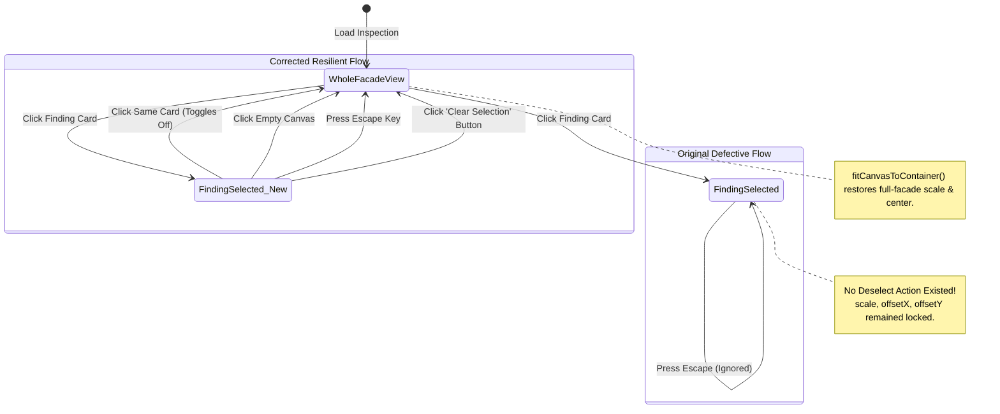

# P0 Selection State & Canvas Reset: Root Cause Analysis

## 1. Observed Issue

When an engineer or inspector clicked any finding card in the **Screened Visual Findings** sidebar:
1. The canvas zoomed in on that finding's bounding box (`fitFindingToCanvas(id)`).
2. The card received a blue outline (`.selected` CSS class).
3. **The Failure:** 
   - Clicking the card again did nothing.
   - Clicking on empty space on the canvas did nothing.
   - Pressing the `Escape` key did nothing.
   - There was no "Clear Selection" or "Reset View" button in either the viewport toolbar or the findings list header.
   - The only way to restore the full facade view was to manually reload the entire page or zoom out using mousewheel step-by-step.

---

## 2. Code Trace & State Machine Breakdown

### 2.1 State Flow Comparison



---

## 3. Detailed Root Causes in `neev/app/static/app.js`

### Root Cause 1: Lack of Toggle Logic on Finding Cards
In the finding card rendering function:
```javascript
// DEFECTIVE IMPLEMENTATION:
card.addEventListener("click", () => {
  AppState.selectedFindingId = f.id;
  document.querySelectorAll(".finding-card").forEach(c => c.classList.remove("selected"));
  card.classList.add("selected");
  fitFindingToCanvas(f.id);
  renderCanvas();
});
```
Because `AppState.selectedFindingId` was always assigned `f.id` without checking if `AppState.selectedFindingId === f.id`, clicking the card a second time simply re-selected it and re-triggered `fitFindingToCanvas(f.id)`.

### Root Cause 2: Missing Deselection in Canvas Background Click Handler
The canvas click listener was designed exclusively to detect bounding box hits:
```javascript
// DEFECTIVE IMPLEMENTATION:
container.addEventListener("click", (e) => {
  const hit = findFindingAtCanvasPos(mousePos.x, mousePos.y);
  if (hit) {
    selectFinding(hit.id);
  }
  // Missing else branch! Clicking empty background was a no-op.
});
```
When clicking on the facade image background outside of a bounding box, the handler did nothing.

### Root Cause 3: Absence of Keyboard Shortcuts
No global or document-level `keydown` event listener was registered for the `Escape` (`Esc`) key. Keyboard-centric users had no way to exit zoom mode.

### Root Cause 4: Missing Explicit UI Controls
Neither the Viewport Toolbar (`#viewport-toolbar`) nor the Screened Visual Findings Panel (`#findings-panel-header`) provided a button to clear the active finding or reset the view.

### Root Cause 5: Permanent Viewport State Alteration
When `fitFindingToCanvas(f.id)` executed, it modified `AppState.viewport.scale`, `AppState.viewport.offsetX`, and `AppState.viewport.offsetY` to frame the bounding box with 20% margin. Without a reset handler to call `fitCanvasToContainer()`, the canvas remained zoomed in indefinitely.

